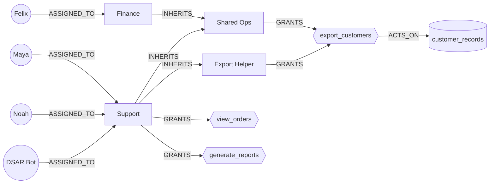

# CUTLINE

**Repair excessive permissions without breaking the work that still has to happen — and prove the repair worked.**

CUTLINE is a graph-native permission-repair agent built on **FalkorDB**. Give it a capability that must disappear and
the business workflows that must survive. FalkorDB traces every route to the dangerous capability; a deterministic
planner generates structural repairs and tests each one on an **isolated FalkorDB graph**, rejecting unsafe ones with
counterexamples; the chosen repair is verified with **real HTTP requests** against a running application, applied only
after human approval with a revision-guarded atomic write, and shipped with executable regression tests. When the
policy changes underneath it, the evidence goes **stale** — CUTLINE refuses to apply it and replans.

> **Track:** 01 — Agents That Act on Connected Data (multi-hop reasoning · graph queries as agent tools · tool
> selection through MCP · actions based on what the graph shows · explainable results)

---

## The problem, in 20 seconds

```
POST /demo/customers/export      X-Cutline-Principal: maya      →  200 OK · 1,000 customer records
```

Maya is a support agent. She should look up orders and generate reports — never bulk-export customer data. She can,
through **two independent inherited paths**:

```
maya → Support → Shared Ops    → export_customers      (Shared Ops is also how Finance exports)
maya → Support → Export Helper → export_customers      (Export Helper was attached so the DSAR bot could export)
```

Every obvious fix breaks something:

| Obvious fix | What FalkorDB proves on an isolated copy of the graph |
|---|---|
| Revoke `export_customers` from Shared Ops | ❌ Felix loses export → **Finance close breaks**; Maya still exports via Export Helper |
| Detach Shared Ops from Support | ❌ `maya → support → export_helper → export_customers` is still open |
| Detach Export Helper from Support | ❌ `maya → support → shared_ops → export_customers` is still open |
| Detach both bundles from Support | ❌ DSAR Bot loses export → **legally required DSAR fulfilment breaks** |
| **Create `support_safe` (view_orders, generate_reports), move Maya + Noah onto it** | ✅ all guardrails hold, all workflows survive, no new access |

## What CUTLINE does

1. **Discover** — FalkorDB returns every bounded access path (`[:INHERITS*0..6]`) for each guardrail violation.
2. **Contract** — guardrails (`must_deny`) and workflows (`must_allow`) are nodes in the graph; an operator can add
   constraints in natural language, which are parsed into a typed contract and confirmed before use.
3. **Plan** — bounded, deterministic candidate generation (single cuts, minimal hitting sets, scoped-role migration),
   each candidate applied to its own `GRAPH.COPY` of the policy and re-checked by FalkorDB. Failures carry a witness
   path or the broken workflow. Cheapest passing candidate under a transparent cost model wins.
4. **Verify** — real requests to the synthetic Customer Ops API, decided by an **independent enforcement point**
   (reference closure engine or Open Policy Agent) that reads the candidate graph. Graph prediction and runtime
   decision must agree on every check.
5. **Approve & apply** — a human approves; the edits land in **one atomic Cypher statement** guarded by a
   compare-and-set on the policy revision; post-apply verification re-runs against the live policy.
6. **Stay honest** — evidence is bound to a revision *and* a content hash: a live mutation (or an out-of-band edit in
   FalkorDB Browser) makes it stale, apply is refused, and the agent replans. Regression tests (JSON + pytest) pin
   every decision.

## Why FalkorDB is essential

FalkorDB is not a visualisation layer — it is the state space CUTLINE reasons over:

| Work | Done by FalkorDB |
|---|---|
| Effective-access reachability and multi-path witnesses | variable-length Cypher traversal |
| Business intent (workflows, guardrails) and the derived contract | graph nodes + relationships |
| Candidate isolation | `GRAPH.COPY` → one throw-away graph per candidate |
| Counterexamples (forbidden path still open, workflow lost, new privilege) | re-query on the candidate graph |
| Atomic, revision-guarded application | single parameterised Cypher statement |
| Evidence ledger and cross-session agent memory | `cutline_dev__ledger` graph with `(:Repair)-[:BASED_ON]->(:Revision)` |
| What the enforcement point reads at runtime | one-hop relations from the selected graph |

Remove FalkorDB and nothing works: `tests/test_falkordb_unavailable.py` points the app at a dead port and asserts that
every analysis/repair endpoint returns `503 FALKORDB_UNAVAILABLE` and the protected app fails closed. There is no
fallback store.

## Graph model



| Label | Key properties | Meaning |
|---|---|---|
| `User` | `id`, `name`, `department`, `principal_type` (human/service) | principal |
| `Role` | `id`, `name`, `origin` (idp / cutline / challenge) | permission bundle |
| `Capability` | `id`, `sensitivity`, `method`, `endpoint` | operation on the app |
| `Resource` | `id`, `classification` | data a capability acts on |
| `Workflow` | `id`, `name`, `criticality` | business process that must survive |
| `Guardrail` | `id`, `description` | security rule that must hold |
| `Policy` | `id='active'`, `revision`, `updated_at`, `last_change` | revision boundary |

Relationships (direction matters — `A INHERITS B` means A receives B's grants): `(User)-[:ASSIGNED_TO]->(Role)`,
`(Role)-[:INHERITS]->(Role)`, `(Role)-[:GRANTS]->(Capability)`, `(Capability)-[:ACTS_ON]->(Resource)`,
`(Workflow)-[:REQUIRES]->(Capability)`, `(User)-[:PERFORMS]->(Workflow)`, `(Guardrail)-[:FORBIDS]->(Capability)`,
`(Guardrail)-[:APPLIES_TO]->(User)`. Ids are unique (range index + `GRAPH.CONSTRAINT UNIQUE` on User/Role/Capability).

## Core Cypher

All in [backend/app/db/queries.py](backend/app/db/queries.py). Values are always parameters; variable-length bounds
(which Cypher cannot parameterise) are validated integers.

```cypher
-- every bounded access path (a direct grant is the zero-hop case)
MATCH p = (u:User {id: $principal})-[:ASSIGNED_TO]->(:Role)-[:INHERITS*0..6]->(:Role)-[:GRANTS]->(c:Capability {id: $capability})
RETURN DISTINCT [n IN nodes(p) | n.id] AS node_ids, [r IN relationships(p) | type(r)] AS rel_types

-- the same for a batch of (principal, capability) pairs in one round trip
UNWIND $pairs AS pair
MATCH p = (u:User)-[:ASSIGNED_TO]->(:Role)-[:INHERITS*0..6]->(:Role)-[:GRANTS]->(c:Capability)
WHERE u.id = pair.principal AND c.id = pair.capability
RETURN DISTINCT u.id AS principal, c.id AS capability, [n IN nodes(p) | n.id] AS node_ids, [r IN relationships(p) | type(r)] AS rel_types

-- effective access matrix (used for "no new privilege" and "no collateral loss")
MATCH (u:User)-[:ASSIGNED_TO]->(:Role)-[:INHERITS*0..6]->(:Role)-[:GRANTS]->(c:Capability)
RETURN DISTINCT u.id AS principal, c.id AS capability

-- one-hop relations: all the independent enforcement point is allowed to read
MATCH (a)-[r]->(b) WHERE type(r) IN ['ASSIGNED_TO', 'INHERITS', 'GRANTS'] RETURN type(r), a.id, b.id
```

Applying a repair is **one statement**: every precondition is a `MATCH` placed before any write (including the
revision compare-and-set), so a moved revision or a missing edge yields zero rows and writes nothing; otherwise the
revision bump, role creation, `MERGE`s and `DELETE`s commit together (a single FalkorDB query is atomic):

```cypher
-- generated for the support_safe migration (params: n0_id=generate_reports, n1_id=view_orders, n2_id=maya,
-- n3_id=noah, n4_id=support, cr0_id=support_safe)
MATCH (pol:Policy {id: 'active'}) WHERE pol.revision = $expected_revision
MATCH (n0:Capability {id: $n0_id})
MATCH (n1:Capability {id: $n1_id})
MATCH (n2:User {id: $n2_id})
MATCH (n3:User {id: $n3_id})
MATCH (n4:Role {id: $n4_id})
MATCH (n2)-[x5:ASSIGNED_TO]->(n4)
MATCH (n3)-[x6:ASSIGNED_TO]->(n4)
SET pol.revision = pol.revision + 1, pol.updated_at = $ts, pol.last_change = $change
MERGE (cr0:Role {id: $cr0_id}) ON CREATE SET cr0.name = $cr0_name, cr0.origin = 'cutline'
MERGE (cr0)-[:GRANTS]->(n0)
MERGE (cr0)-[:GRANTS]->(n1)
MERGE (n2)-[:ASSIGNED_TO]->(cr0)
MERGE (n3)-[:ASSIGNED_TO]->(cr0)
DELETE x5
DELETE x6
RETURN pol.revision AS revision
```

## Repair algorithm

* **Candidates** (deterministic order, explicit budget: `MAX_CANDIDATES=24`, `MAX_CUT_SIZE=3`, `MAX_DEPTH=6`):
  `single_cut` (every role-level edge on a forbidden path), `multi_cut` (minimal hitting sets of the forbidden paths),
  `scoped_role_migration` (new `<role>_safe` granting exactly what the subjects keep; reassign them).
* **Evaluation** — each candidate on its own FalkorDB graph: must_deny unreachable, must_allow reachable, no new
  `(principal, capability)` pair. Outcome `PASS` / `FAIL_REQUIRED_WORKFLOW` / `FAIL_FORBIDDEN_PATH` /
  `FAIL_NEW_PRIVILEGE` with witnesses.
* **Cost** — Σ edit weights (create role 2, others 1) + 2 per edit that mutates a pre-existing role held by
  principals outside the contract's subjects (blast radius) + 3 per undeclared capability lost.
* **Honesty** — if nothing passes within budget the plan is `INFEASIBLE_WITHIN_BUDGET`; CUTLINE removes access and
  never invents new grants. Residual risk is reported (e.g. "Support still reaches export_customers and is now held
  only by DSAR Bot").

## Verification model

| | Planner | Enforcement point |
|---|---|---|
| Reads | full policy graph + variable-length Cypher | one-hop relations from the selected graph |
| Decides with | FalkorDB reachability | `reference` fixpoint closure **or** OPA (`policies/cutline_authz.rego`, `graph.reachable`) |
| Used for | proposing / predicting | serving `/demo/orders`, `/demo/reports`, `/demo/customers/export` |

A check passes only if the HTTP decision equals the contract's expectation **and** FalkorDB's prediction. Candidate
verification targets `X-Cutline-Policy: candidate:<repair_id>`; post-apply verification targets `active`.

## Agent + MCP (Track 01)

`POST /api/agent/investigate` runs an agent over 11 typed tools. With `ANTHROPIC_API_KEY` set it is **Claude Opus
5.5** choosing tools in a manual tool-use loop (append-only history, prompt caching, server-side refusal fallback);
without a key the same tools run in a fixed order and the response says `mode: "deterministic"`. The model never
writes Cypher and can never approve — the deterministic verifier, not the LLM, decides safety.

The same tools are an MCP server (MCP Python SDK v2):

```bash
cd backend && .venv/Scripts/python -m app.mcp_server                # stdio
claude mcp add cutline -- <abs path>/backend/.venv/Scripts/python -m app.mcp_server
```

| Tool | Kind | Purpose |
|---|---|---|
| `inspect_policy`, `find_risks`, `trace_access`, `check_access` | read | multi-hop investigation |
| `recall_history` | read | memory across sessions from the FalkorDB ledger |
| `get_contract` | read | derived contract, or NL → contract proposal |
| `propose_repair`, `verify_repair` | write (isolated) | plan on candidate graphs; runtime proof |
| `get_evidence`, `export_regression_tests` | read | revision-bound evidence, pytest suite |
| `apply_repair` | destructive | only after a human approved it in the console |

## Run it

**Option A — FalkorDB Cloud** (what we use): put the endpoint in `backend/.env`:

```bash
cd backend
cp .env.example .env        # FALKORDB_HOST / FALKORDB_PORT / FALKORDB_USERNAME=falkordb / FALKORDB_PASSWORD
py -3.11 -m venv .venv && .venv/Scripts/pip install -r requirements.txt     # (Linux/macOS: .venv/bin/...)
.venv/Scripts/python -m scripts.falkordb_smoke                              # checks every Cypher shape we use
.venv/Scripts/python -m uvicorn app.main:app --port 8000                    # seeds the scenario on first start
```

**Option B — everything in Docker** (FalkorDB + OPA + API + console): `docker compose up --build`, then open
http://localhost:3000 (FalkorDB Browser on http://localhost:3001).

Console: `cd frontend && npm install && npm run dev` (proxies `/api` to `CUTLINE_API_URL`, default
`http://127.0.0.1:8000`). http://localhost:3000 is the project landing page (it renders without the API);
the console starts at http://localhost:3000/overview.

Tests: `cd backend && .venv/Scripts/python -m pytest` (unit + live-socket tests).
Real FalkorDB end-to-end: `CUTLINE_TEST_FALKORDB=1 .venv/Scripts/python -m pytest -m falkordb -v`.
OPA engine: run `opa run --server --addr 127.0.0.1:8181 policies/cutline_authz.rego`, then
`CUTLINE_TEST_OPA_URL=http://127.0.0.1:8181 pytest tests/test_opa_engine.py`.

## Benchmarks

`backend/benchmarks/` holds ten synthetic scenarios with known correct outcomes: the demo scenario, a bundled
role, a private nested chain, an inheritance cycle, an assignment-only fix, two forbidden capabilities, subjects
with different keep-sets, an infeasible requirement, an already-safe policy, and an 8-hop chain beyond the planner's
6-hop bound. CUTLINE is compared with a greedy "revoke at the granting role" repair and a direct-grant-only checker;
every chosen repair is re-checked by the independent engine on the repaired graph.

```bash
cd backend && .venv/Scripts/python -m benchmarks.run        # runs against FalkorDB from backend/.env, writes docs/benchmarks.md
```

Results on **FalkorDB Cloud** (ap-south-1, engine 4.22) — full table in [docs/benchmarks.md](docs/benchmarks.md):

| Metric | CUTLINE | Baseline |
|---|---|---|
| Correct outcome (repair / refuse / flag as expected) | **10/10** | — |
| Safe repair rate on repairable scenarios | **7/7** | greedy revoke-at-source: 2/7 |
| Forbidden access detected | 11/12 (the 12th is beyond the depth bound and is flagged by the independent engine) | direct-grant checker: 7/12 |
| Median planning time (all candidates on isolated graphs) | 1.46 s | — |

### Verified on real FalkorDB

* `scripts/falkordb_smoke.py` — every Cypher shape CUTLINE uses (zero-hop traversal, batched pair paths,
  `GRAPH.COPY`, the atomic composite write, the revision compare-and-set, the ledger) passes on FalkorDB Cloud.
* `pytest -m falkordb` — the full lifecycle (plan → runtime verification over real HTTP → approval → atomic apply with
  exact write counts → live mutation → stale evidence → replan) passes against FalkorDB Cloud.
* `frontend/scripts/e2e-live.mjs` — drives the production console through the whole demo against the live API with
  no request interception and fails on any API or browser error.

## Three-minute demo

1. **Breach** — `POST /demo/customers/export` as Maya → `200`. "Support should never bulk-export customers."
2. **Graph** — Access Graph, select `export_customers`: two amber routes from Support; Finance and the DSAR bot have
   legitimate routes through the *same* roles.
3. **Plan** — Repair Studio → *Generate safe repair*: watch the obvious fixes get rejected with counterexamples
   (Finance close breaks; the other path stays open; DSAR fulfilment breaks).
4. **Structural repair** — `support_safe` with exactly `view_orders` + `generate_reports`; Maya and Noah move.
5. **Proof** — *Run verification*: Maya export `403`, Maya orders `200`, Felix export `200`, DSAR bot export `200`.
6. **Approve & apply** — revision r1 → r2, one atomic write, post-apply checks pass; export the pytest suite.
7. **Break it again** — *Introduce new export path* (Contractor Tools attached to Maya's role): evidence turns
   **stale**, apply is refused, the new path is traced, the agent replans and cuts only the new edge.

## API

`GET /api/health` · `GET /api/scenarios` · `POST /api/scenarios/customer-ops/reset` · `GET /api/graph` ·
`GET /api/policy/revision` · `POST /api/access/paths` · `POST /api/access/check` · `GET /api/risks` ·
`GET /api/contract` · `POST /api/contract/parse` · `POST /api/repairs/plan` · `GET /api/repairs` ·
`GET /api/repairs/{id}` · `POST /api/repairs/{id}/verify|approve|apply` · `GET /api/evidence/{id}` ·
`GET /api/regression-tests/{id}` · `GET /api/regression-tests/{id}/export?format=json|pytest` · `GET /api/activity` ·
`POST /api/demo/mutate-policy` · `POST /api/agent/investigate` — full shapes in
[docs/API_CONTRACT.md](docs/API_CONTRACT.md); interactive docs at `/docs`.

## Security design

| Threat | Control |
|---|---|
| LLM invents or drops requirements | NL contract is a proposal; operator confirms; graph workflows are always merged in |
| Agent mutates policy directly | typed allowlisted edits only; no Cypher tool; `apply` needs human approval |
| Plan applied to an outdated graph | revision compare-and-set in the write + content-hash drift detection |
| Partial migration | single atomic statement; all preconditions matched before any write |
| Repair introduces new access | effective-access diff on the candidate graph (`FAIL_NEW_PRIVILEGE`) |
| Graph and runtime disagree | verification fails; independent engine reads only one-hop relations |
| Arbitrary graph access via headers | `X-Cutline-Policy` resolves only `active` or a known repair's candidate graph |
| Real customer data | synthetic dataset only; principal header is a demo selector, not authentication |

## Supported semantics (and not)

Supported: allow-only RBAC with role inheritance, named principals and capabilities, bounded depth (default 6).
Not modelled: deny precedence, conditions/ABAC, time-bound grants, resource-scoped grants, cloud IAM policy languages.
Unsupported constructs are not silently approximated — CUTLINE only claims what its declared model can prove.

## AI tools disclosure

This project was built during the hackathon window with substantial help from **Claude Code** (Anthropic) as an AI
coding assistant — research, code generation, tests and documentation. The optional in-app agent calls the Claude API
(Claude Opus 5.5). *Team: add your own contribution notes here; the rules require that you can explain the graph
model, queries and architecture.*
