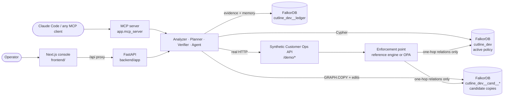

# CUTLINE

**Repair excessive permissions without breaking the work that still has to happen, and prove the repair worked.**

CUTLINE is a graph-native permission-repair agent built on **FalkorDB**. You tell it which capability must disappear
and which business workflows must survive. FalkorDB traces every route to the dangerous capability. A deterministic
planner generates structural repairs and tests each one on its own **isolated FalkorDB graph**, rejecting the unsafe
ones with counterexamples. The chosen repair is proven with **real HTTP requests** against a running application,
applied only after a human approves it (one revision-guarded, atomic Cypher write), and shipped with executable
regression tests. If the policy changes underneath it, the evidence goes **stale**: CUTLINE refuses to apply it and
plans again.

## The problem

```
POST /demo/customers/export      X-Cutline-Principal: maya      →  200 OK · 1,000 customer records
```

Maya is a support agent. She should look up orders and generate reports, and never bulk-export customer data. She can
export anyway, through **two independent inherited paths**:

```
maya → Support → Shared Ops    → export_customers      (Shared Ops is also how Finance exports)
maya → Support → Export Helper → export_customers      (Export Helper was attached so the DSAR bot could export)
```

Every obvious fix breaks something:

| Obvious fix | What FalkorDB proves on an isolated copy of the graph |
|---|---|
| Revoke `export_customers` from Shared Ops | ❌ Felix loses export → **Finance close breaks**; Maya still exports via Export Helper |
| Detach Shared Ops from Support | ❌ `maya → support → export_helper → export_customers` is still open |
| Detach Export Helper from Support | ❌ `maya → support → shared_ops → export_customers` is still open |
| Detach both bundles from Support | ❌ DSAR Bot loses export → **legally required DSAR fulfilment breaks** |
| **Create `support_safe` (view_orders, generate_reports), move Maya and Noah onto it** | ✅ every guardrail holds, every workflow survives, no new access |

A human reviewer has to hold all of these routes and dependencies in their head at once. CUTLINE makes the graph do it.

## How CUTLINE works

1. **Discover.** FalkorDB returns every bounded access path (`[:INHERITS*0..6]`) for each guardrail violation.
2. **Contract.** Guardrails (`must_deny`) and workflows (`must_allow`) are nodes in the graph. An operator can add
   constraints in natural language; they are parsed into a typed contract and confirmed before use.
3. **Plan.** Bounded, deterministic candidate generation (single cuts, minimal hitting sets, scoped-role migration).
   Each candidate is applied to its own `GRAPH.COPY` of the policy and re-checked by FalkorDB. A failure carries a
   witness path or the broken workflow. The cheapest passing candidate under a transparent cost model wins.
4. **Verify.** Real requests to the synthetic Customer Ops API, decided by an **independent enforcement point**
   (a reference closure engine, or Open Policy Agent) that reads the candidate graph. The graph prediction and the
   runtime decision must agree on every check.
5. **Approve and apply.** A human approves. The edits land in **one atomic Cypher statement** guarded by a
   compare-and-set on the policy revision. Post-apply verification re-runs against the live policy.
6. **Stay honest.** Evidence is bound to a revision *and* a content hash. A live mutation (or an out-of-band edit in
   FalkorDB Browser) makes it stale, apply is refused, and the agent plans again. Regression tests (JSON and pytest)
   pin every decision.

## Architecture



| Layer | Technology |
|---|---|
| Graph database | FalkorDB (FalkorDB Cloud engine 4.22, or the `falkordb/falkordb` Docker image), `falkordb` Python client 1.8 |
| API | Python 3.11, FastAPI, Pydantic v2, uvicorn |
| Agent | Claude API (Claude Opus 5.5) tool-use loop, optional; deterministic fallback without a key |
| Tools protocol | MCP Python SDK v2 (stdio or streamable HTTP) |
| Independent enforcement | built-in reference closure engine, or Open Policy Agent 1.21 with [backend/policies/cutline_authz.rego](backend/policies/cutline_authz.rego) |
| Console | Next.js 16, React 19, TanStack Query, React Flow (graph view), three.js (landing page) |

## Track 01 fit

| Track 01 focus | What CUTLINE does |
|---|---|
| Multi-hop reasoning | Variable-length traversals (`ASSIGNED_TO → INHERITS*0..6 → GRANTS`) find every route, not just direct grants |
| Graph queries and algorithms as agent tools | 11 typed tools (trace, check, plan, verify, recall …) wrap the Cypher below; the model never writes Cypher |
| Tool selection through MCP | The same tools are served by an MCP server; Claude chooses which to call |
| Actions based on what the graph shows | Repairs are generated from the witness paths and applied as graph edits after approval |
| Explainable results | Every rejected candidate carries a counterexample path or the workflow it breaks; every pass carries runtime evidence |
