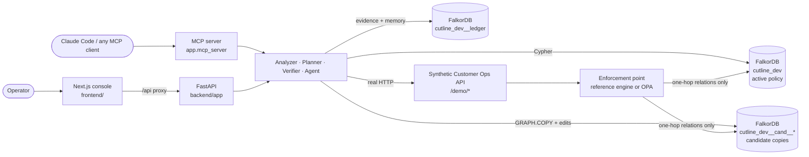
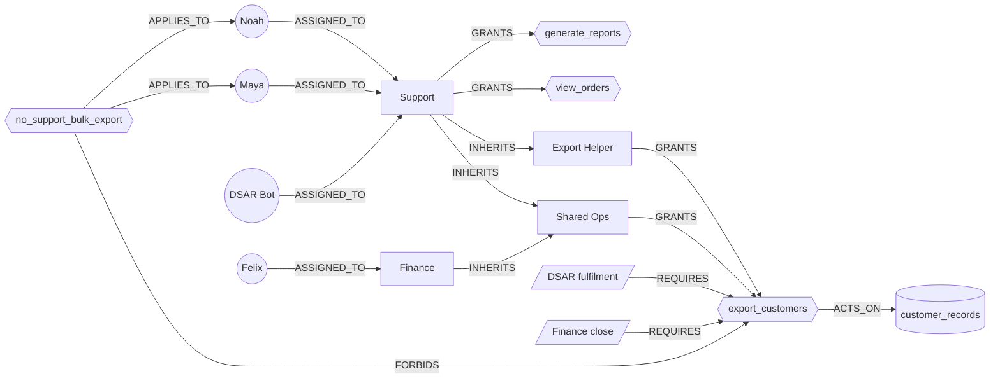

# CUTLINE

**Repair excessive permissions without breaking the work that still has to happen, and prove the repair worked.**

CUTLINE is a graph-native permission-repair agent built on **FalkorDB**. You tell it which capability must disappear
and which business workflows must survive. FalkorDB traces every route to the dangerous capability. A deterministic
planner generates structural repairs and tests each one on its own **isolated FalkorDB graph**, rejecting the unsafe
ones with counterexamples. The chosen repair is proven with **real HTTP requests** against a running application,
applied only after a human approves it (one revision-guarded, atomic Cypher write), and shipped with executable
regression tests. If the policy changes underneath it, the evidence goes **stale**: CUTLINE refuses to apply it and
plans again.

## The problem

```
POST /demo/customers/export      X-Cutline-Principal: maya      →  200 OK · 1,000 customer records
```

Maya is a support agent. She should look up orders and generate reports, and never bulk-export customer data. She can
export anyway, through **two independent inherited paths**:

```
maya → Support → Shared Ops    → export_customers      (Shared Ops is also how Finance exports)
maya → Support → Export Helper → export_customers      (Export Helper was attached so the DSAR bot could export)
```

Every obvious fix breaks something:

| Obvious fix | What FalkorDB proves on an isolated copy of the graph |
|---|---|
| Revoke `export_customers` from Shared Ops | ❌ Felix loses export → **Finance close breaks**; Maya still exports via Export Helper |
| Detach Shared Ops from Support | ❌ `maya → support → export_helper → export_customers` is still open |
| Detach Export Helper from Support | ❌ `maya → support → shared_ops → export_customers` is still open |
| Detach both bundles from Support | ❌ DSAR Bot loses export → **legally required DSAR fulfilment breaks** |
| **Create `support_safe` (view_orders, generate_reports), move Maya and Noah onto it** | ✅ every guardrail holds, every workflow survives, no new access |

A human reviewer has to hold all of these routes and dependencies in their head at once. CUTLINE makes the graph do it.

## How CUTLINE works

1. **Discover.** FalkorDB returns every bounded access path (`[:INHERITS*0..6]`) for each guardrail violation.
2. **Contract.** Guardrails (`must_deny`) and workflows (`must_allow`) are nodes in the graph. An operator can add
   constraints in natural language; they are parsed into a typed contract and confirmed before use.
3. **Plan.** Bounded, deterministic candidate generation (single cuts, minimal hitting sets, scoped-role migration).
   Each candidate is applied to its own `GRAPH.COPY` of the policy and re-checked by FalkorDB. A failure carries a
   witness path or the broken workflow. The cheapest passing candidate under a transparent cost model wins.
4. **Verify.** Real requests to the synthetic Customer Ops API, decided by an **independent enforcement point**
   (a reference closure engine, or Open Policy Agent) that reads the candidate graph. The graph prediction and the
   runtime decision must agree on every check.
5. **Approve and apply.** A human approves. The edits land in **one atomic Cypher statement** guarded by a
   compare-and-set on the policy revision. Post-apply verification re-runs against the live policy.
6. **Stay honest.** Evidence is bound to a revision *and* a content hash. A live mutation (or an out-of-band edit in
   FalkorDB Browser) makes it stale, apply is refused, and the agent plans again. Regression tests (JSON and pytest)
   pin every decision.

## Architecture



| Layer | Technology |
|---|---|
| Graph database | FalkorDB (FalkorDB Cloud engine 4.22, or the `falkordb/falkordb` Docker image), `falkordb` Python client 1.8 |
| API | Python 3.11, FastAPI, Pydantic v2, uvicorn |
| Agent | Claude API (Claude Opus 5.5) tool-use loop, optional; deterministic fallback without a key |
| Tools protocol | MCP Python SDK v2 (stdio or streamable HTTP) |
| Independent enforcement | built-in reference closure engine, or Open Policy Agent 1.21 with [backend/policies/cutline_authz.rego](backend/policies/cutline_authz.rego) |
| Console | Next.js 16, React 19, TanStack Query, React Flow (graph view), three.js (landing page) |

## Track 01 fit

| Track 01 focus | What CUTLINE does |
|---|---|
| Multi-hop reasoning | Variable-length traversals (`ASSIGNED_TO → INHERITS*0..6 → GRANTS`) find every route, not just direct grants |
| Graph queries and algorithms as agent tools | 11 typed tools (trace, check, plan, verify, recall …) wrap the Cypher below; the model never writes Cypher |
| Tool selection through MCP | The same tools are served by an MCP server; Claude chooses which to call |
| Actions based on what the graph shows | Repairs are generated from the witness paths and applied as graph edits after approval |
| Explainable results | Every rejected candidate carries a counterexample path or the workflow it breaks; every pass carries runtime evidence |

---

## Graph data model

CUTLINE keeps three kinds of graph in FalkorDB. Names derive from `FALKORDB_GRAPH` (default `cutline_dev`).

| Graph | Name | Holds | Lifetime |
|---|---|---|---|
| Active policy | `cutline_dev` | Users, roles, capabilities, resources, workflows, guardrails, policy revision | Seeded on first start |
| Candidate | `cutline_dev__cand__<repair_id>__<n>` | A `GRAPH.COPY` of the active policy with one candidate repair applied | Created per candidate, deleted after use |
| Ledger | `cutline_dev__ledger` | Repairs, the revisions they are based on, and an activity log (agent memory across sessions) | Created on first write |

### Policy graph



**Node labels**

| Label | Properties | Meaning |
|---|---|---|
| `User` | `id`, `name`, `department`, `principal_type` (`human` / `service`), `title` | A principal: a person or a service account |
| `Role` | `id`, `name`, `description`, `origin` (`idp` / `cutline` / `challenge`) | A permission bundle; `origin = 'cutline'` marks roles CUTLINE created |
| `Capability` | `id`, `name`, `sensitivity`, `method`, `endpoint` | An operation on the application (maps to an HTTP endpoint) |
| `Resource` | `id`, `name`, `classification` | Data a capability acts on |
| `Workflow` | `id`, `name`, `criticality`, `description` | A business process that must keep working (`must_allow`) |
| `Guardrail` | `id`, `description` | A security rule that must hold (`must_deny`) |
| `Policy` | `id = 'active'`, `revision`, `updated_at`, `scenario`, `last_change` | The revision boundary every plan and write is checked against |

**Relationships** (direction matters: `A INHERITS B` means A receives B's grants)

| Relationship | From → To | Meaning |
|---|---|---|
| `ASSIGNED_TO` | `User → Role` | The principal holds the role |
| `INHERITS` | `Role → Role` | The role receives everything the parent role grants (transitively) |
| `GRANTS` | `Role → Capability` | The role allows the operation |
| `ACTS_ON` | `Capability → Resource` | The operation reads or writes this data |
| `REQUIRES` | `Workflow → Capability` | The workflow needs this capability |
| `PERFORMS` | `User → Workflow` | The principal carries out the workflow |
| `FORBIDS` | `Guardrail → Capability` | The guardrail bans this capability … |
| `APPLIES_TO` | `Guardrail → User` | … for these principals |

**Effective access** is derived, never stored: a user can perform a capability if a path
`(User)-[:ASSIGNED_TO]->(:Role)-[:INHERITS*0..6]->(:Role)-[:GRANTS]->(Capability)` exists. The **contract** is also
derived from the graph: each `(Guardrail)-[:APPLIES_TO]->(User)` × `(Guardrail)-[:FORBIDS]->(Capability)` pair must be
unreachable, and each `(User)-[:PERFORMS]->(Workflow)-[:REQUIRES]->(Capability)` pair must stay reachable.

**Indexes and constraints.** A range index on `id` for every label, plus `GRAPH.CONSTRAINT` unique constraints on
`User.id`, `Role.id` and `Capability.id`.

**Seeded dataset.** The *Customer Operations* scenario ([backend/app/db/scenario.py](backend/app/db/scenario.py)):
19 nodes (4 users, 4 roles, 3 capabilities, 3 resources, 3 workflows, 1 guardrail, 1 policy) and 25 relationships.
All data is synthetic (Rule 6); no real people or customer records are loaded. The ten benchmark scenarios (this one
plus nine variations) live in [backend/benchmarks/scenarios.py](backend/benchmarks/scenarios.py).

### Ledger graph (evidence and agent memory)

```
(:Repair {id, doc, status, created_at, updated_at})-[:BASED_ON]->(:Revision {n, hash})
(:Event  {id, ts, kind, summary, revision, repair_id})-[:AT]->(:Revision {n})
```

Every plan is pinned to the revision and content hash it was computed on. The agent's `recall_history` tool reads this
graph, which is how it remembers earlier repairs across sessions.

---

## Cypher queries the product depends on

Every statement lives in [backend/app/db/queries.py](backend/app/db/queries.py). Values are always parameters. The
only text formatted into a query is the variable-length bound (Cypher cannot parameterise it; it is a validated
integer from 1 to 10) and labels or relationship types taken from fixed allowlists.

### Reads: multi-hop access analysis

```cypher
// 1. Every bounded access path from one principal to one capability (a direct grant is the zero-hop case).
//    Powers "trace access", the guardrail witnesses, and counterexamples on candidate graphs.
MATCH p = (u:User {id: $principal})-[:ASSIGNED_TO]->(:Role)-[:INHERITS*0..6]->(:Role)-[:GRANTS]->(c:Capability {id: $capability})
RETURN DISTINCT [n IN nodes(p) | n.id] AS node_ids, [r IN relationships(p) | type(r)] AS rel_types

// 2. The same for a batch of (principal, capability) pairs in one round trip (every must_deny / must_allow pair).
UNWIND $pairs AS pair
MATCH p = (u:User)-[:ASSIGNED_TO]->(:Role)-[:INHERITS*0..6]->(:Role)-[:GRANTS]->(c:Capability)
WHERE u.id = pair.principal AND c.id = pair.capability
RETURN DISTINCT u.id AS principal, c.id AS capability,
       [n IN nodes(p) | n.id] AS node_ids, [r IN relationships(p) | type(r)] AS rel_types

// 3. The effective access matrix. Diffing it before and after a candidate detects
//    new privileges (FAIL_NEW_PRIVILEGE) and collateral loss.
MATCH (u:User)-[:ASSIGNED_TO]->(:Role)-[:INHERITS*0..6]->(:Role)-[:GRANTS]->(c:Capability)
RETURN DISTINCT u.id AS principal, c.id AS capability

// 4. One-hop relations: all the independent enforcement point is allowed to read.
MATCH (a)-[r]->(b) WHERE type(r) IN ['ASSIGNED_TO', 'INHERITS', 'GRANTS']
RETURN type(r) AS type, a.id AS source, b.id AS target

// 5. Snapshot for the console graph view and the content hash used for drift detection.
MATCH (n) RETURN labels(n) AS labels, properties(n) AS props
MATCH (a)-[r]->(b) RETURN type(r) AS type, a.id AS source, b.id AS target
MATCH (p:Policy {id: 'active'}) RETURN p.revision AS revision, p.updated_at AS updated_at
```

### Writes: seeding

```cypher
UNWIND $rows AS row CREATE (n:User {id: row.id}) SET n.name = row.name, n.department = row.department, ...
UNWIND $rows AS row MATCH (a:User), (b:Role) WHERE a.id = row.s AND b.id = row.t CREATE (a)-[:ASSIGNED_TO]->(b)
CREATE INDEX FOR (n:User) ON (n.id)
```

### Writes: applying a repair in one atomic statement

Every precondition is a `MATCH` placed before any write, including the revision compare-and-set. A moved revision or a
missing edge yields zero rows and writes nothing. Otherwise the revision bump, role creation, `MERGE`s and `DELETE`s
commit together, because a single FalkorDB query is atomic. This is the statement generated for the `support_safe`
migration:

```cypher
// params: n0_id=generate_reports, n1_id=view_orders, n2_id=maya, n3_id=noah, n4_id=support, cr0_id=support_safe
MATCH (pol:Policy {id: 'active'}) WHERE pol.revision = $expected_revision
MATCH (n0:Capability {id: $n0_id})
MATCH (n1:Capability {id: $n1_id})
MATCH (n2:User {id: $n2_id})
MATCH (n3:User {id: $n3_id})
MATCH (n4:Role {id: $n4_id})
MATCH (n2)-[x5:ASSIGNED_TO]->(n4)
MATCH (n3)-[x6:ASSIGNED_TO]->(n4)
SET pol.revision = pol.revision + 1, pol.updated_at = $ts, pol.last_change = $change
MERGE (cr0:Role {id: $cr0_id}) ON CREATE SET cr0.name = $cr0_name, cr0.origin = 'cutline'
MERGE (cr0)-[:GRANTS]->(n0)
MERGE (cr0)-[:GRANTS]->(n1)
MERGE (n2)-[:ASSIGNED_TO]->(cr0)
MERGE (n3)-[:ASSIGNED_TO]->(cr0)
DELETE x5
DELETE x6
RETURN pol.revision AS revision
```

The planner only emits allowlisted edit types: `CREATE_ROLE`, `ADD_GRANT`, `REMOVE_GRANT`, `ADD_INHERITS`,
`REMOVE_INHERITS`, `ASSIGN_ROLE`, `UNASSIGN_ROLE`.

### Ledger

```cypher
MERGE (r:Repair {id: $id})
SET r.doc = $doc, r.status = $status, r.created_at = $created_at, r.updated_at = $updated_at
WITH r MERGE (v:Revision {n: $base_revision}) ON CREATE SET v.hash = $base_hash
WITH r, v MERGE (r)-[:BASED_ON]->(v)

CREATE (e:Event {id: $id, ts: $ts, kind: $kind, summary: $summary, revision: $revision, repair_id: $repair_id})
WITH e MERGE (v:Revision {n: $revision}) WITH e, v MERGE (e)-[:AT]->(v)

MATCH (r:Repair) RETURN r.doc AS doc ORDER BY r.created_at DESC LIMIT 50
```

### FalkorDB graph commands

| Command | Used for |
|---|---|
| `GRAPH.COPY <active> <candidate>` | One isolated, throw-away graph per repair candidate (falls back to snapshot replay if the server refuses to fork) |
| `GRAPH.QUERY` / `GRAPH.RO_QUERY` | Writes / read-only analysis |
| `GRAPH.LIST`, `GRAPH.DELETE` | Finding and cleaning up candidate graphs; scenario reset |
| `GRAPH.CONSTRAINT CREATE … UNIQUE` | Unique ids on `User`, `Role`, `Capability` |

`backend/scripts/falkordb_smoke.py` runs every one of these query shapes against a scratch graph and prints PASS/FAIL.

## Graph algorithms: the repair planner

Source: [backend/app/services/repair_planner.py](backend/app/services/repair_planner.py).

* **Witness paths.** Query 2 above returns every forbidden path for every `(principal, capability)` the guardrails ban.
* **Candidate generation** (deterministic order, explicit budget `MAX_CANDIDATES=24`, `MAX_CUT_SIZE=3`,
  `MAX_DEPTH=6`):
  * `single_cut`: remove one role-level edge (`INHERITS`, `GRANTS`, `ASSIGNED_TO`) that lies on a forbidden path;
  * `multi_cut`: **minimal hitting sets** of the forbidden paths, i.e. the smallest edge sets that cut *every* path;
  * `scoped_role_migration`: create `<role>_safe` granting exactly what the affected subjects must keep, and reassign
    them to it.
* **Evaluation.** Each candidate is applied to its own `GRAPH.COPY` and FalkorDB re-runs queries 2 and 3 there:
  every `must_deny` pair unreachable, every `must_allow` pair reachable, no new `(principal, capability)` pair.
  Outcome: `PASS`, `FAIL_REQUIRED_WORKFLOW`, `FAIL_FORBIDDEN_PATH` or `FAIL_NEW_PRIVILEGE`, each with a witness.
* **Cost.** Sum of edit weights (create role 2, others 1), plus 2 per edit that mutates a pre-existing role held by
  principals outside the contract's subjects (blast radius), plus 3 per undeclared capability lost.
* **Honesty.** If nothing passes within the budget, the plan is `INFEASIBLE_WITHIN_BUDGET`. CUTLINE removes access and
  never invents new grants. Residual risk is reported (for example "Support still reaches export_customers and is now
  held only by DSAR Bot").
* **Independent check.** The enforcement point computes reachability with its own fixpoint closure over one-hop
  relations (or OPA's `graph.reachable`), so the planner's traversal is never the only judge of its own output.

## Why FalkorDB is essential

FalkorDB is not a visualisation layer. It is the state space CUTLINE reasons over:

| Work | Done by FalkorDB |
|---|---|
| Effective-access reachability and multi-path witnesses | Variable-length Cypher traversal |
| Business intent (workflows, guardrails) and the derived contract | Graph nodes and relationships |
| Candidate isolation | `GRAPH.COPY`: one throw-away graph per candidate |
| Counterexamples (forbidden path still open, workflow lost, new privilege) | Re-queries on the candidate graph |
| Atomic, revision-guarded application | A single parameterised Cypher statement |
| Evidence ledger and cross-session agent memory | `cutline_dev__ledger` with `(:Repair)-[:BASED_ON]->(:Revision)` |
| What the enforcement point reads at runtime | One-hop relations from the selected graph |

Remove FalkorDB and nothing works. [backend/tests/test_falkordb_unavailable.py](backend/tests/test_falkordb_unavailable.py)
points the app at a dead port and asserts that every analysis and repair endpoint returns `503 FALKORDB_UNAVAILABLE`
and the protected app fails closed. There is no fallback store.

---

## Local setup

Two ways to run the complete project on your machine:

* **Path A: Docker Compose.** One command starts FalkorDB, OPA, the API and the console.
* **Path B: native.** Python and Node.js on the host, with FalkorDB from Docker or FalkorDB Cloud. Use this when Docker
  is not available (FalkorDB Cloud's free tier works) or when you want to develop.

### Prerequisites

| Tool | Version | Needed for |
|---|---|---|
| Git | any | cloning |
| Docker with Compose v2 | recent | Path A, or FalkorDB in Path B |
| Python | 3.11+ (tested on 3.11) | Path B backend |
| Node.js and npm | Node 20.9+ (tested on 24) | Path B console |
| FalkorDB Cloud account | free tier | Path B without Docker |
| Open Policy Agent | 1.21 | optional, Path B only |
| Anthropic API key | — | optional, LLM mode of the agent |

```bash
git clone https://github.com/arjitkulkarni/cutline-access_graph.git cutline
cd cutline
```

### Path A: Docker Compose (everything in one command)

```bash
docker compose up --build
# optional, enables the Claude-driven agent:  ANTHROPIC_API_KEY=sk-ant-... docker compose up --build
```

| Service | URL |
|---|---|
| Landing page | http://localhost:3000 |
| Console | http://localhost:3000/overview |
| API docs (Swagger) | http://localhost:8000/docs |
| FalkorDB Browser (graph `cutline_dev`) | http://localhost:3001 |
| OPA | http://localhost:8181 |

The API seeds the Customer Operations scenario into FalkorDB on first start, and runtime verification uses OPA as the
enforcement point. Stop with `Ctrl+C`; `docker compose down` removes the containers (FalkorDB data in the container is
discarded, and CUTLINE re-seeds on the next start). Continue with the [demo walkthrough](#demo-walkthrough).

### Path B: run natively

#### Step 1: start FalkorDB (choose one)

**Option 1: FalkorDB in Docker**

```bash
docker run -d --name cutline-falkordb -p 6379:6379 -p 3001:3000 falkordb/falkordb:latest
```

The defaults in `backend/.env.example` (`FALKORDB_HOST=localhost`, `FALKORDB_PORT=6379`, no password) already point
here. FalkorDB Browser is on http://localhost:3001.

**Option 2: FalkorDB Cloud** (no Docker needed)

1. Create a free instance at https://app.falkordb.cloud.
2. From the instance's **Connectivity** tab copy the host, port and password. The default user is `falkordb`.
3. Put them in `backend/.env` in Step 2. The free tier has no TLS, so keep `FALKORDB_TLS=false`.

> A plain Redis server is **not** FalkorDB. If something else already listens on port 6379 (common on Windows), the API
> reports "a Redis server without the FalkorDB module". Map FalkorDB to another port (`-p 6380:6379`) and set
> `FALKORDB_PORT=6380`.

#### Step 2: start the API

macOS / Linux / Git Bash:

```bash
cd backend
cp .env.example .env                       # then edit the FALKORDB_* lines if you use FalkorDB Cloud
python3.11 -m venv .venv
.venv/bin/pip install -r requirements-dev.txt
.venv/bin/python -m scripts.falkordb_smoke                 # optional: checks every Cypher shape CUTLINE uses
.venv/bin/python -m uvicorn app.main:app --port 8000      # seeds the scenario on first start
```

Windows PowerShell:

```powershell
cd backend
Copy-Item .env.example .env                # then edit the FALKORDB_* lines if you use FalkorDB Cloud
py -3.11 -m venv .venv
.venv\Scripts\pip install -r requirements-dev.txt
$env:PYTHONIOENCODING = "utf-8"            # the smoke script prints arrows
.venv\Scripts\python -m scripts.falkordb_smoke             # optional: checks every Cypher shape CUTLINE uses
.venv\Scripts\python -m uvicorn app.main:app --port 8000  # seeds the scenario on first start
```

On start-up the log shows `FalkorDB ready; active graph 'cutline_dev'`. The smoke test uses a uniquely named scratch
graph and deletes only that graph, so it is safe to run against a shared instance.

> Runtime verification sends real HTTP requests to this same API at `http://127.0.0.1:$BACKEND_PORT`. If you start
> uvicorn on a port other than 8000, set `BACKEND_PORT` in `backend/.env` to the same number.

#### Step 3: check the API

In a second terminal (on Windows PowerShell type `curl.exe`, not `curl`):

```bash
curl http://127.0.0.1:8000/api/health
# {"status":"ok","falkordb":{"connected":true,"graph":"cutline_dev",...},"authz_engine":{"name":"reference",...},...}

curl -X POST http://127.0.0.1:8000/demo/customers/export -H "X-Cutline-Principal: maya"
# 200 {"synthetic":true,"records":1000,...}   <- the breach CUTLINE will repair

curl -X POST http://127.0.0.1:8000/api/access/paths -H "Content-Type: application/json" \
     -d '{"principal":"maya","capability":"export_customers"}'
# on a fresh seed: both inherited routes (via shared_ops and export_helper), plus the Cypher that found them
```

#### Step 4: start the console

```bash
cd frontend
npm ci
npm run dev                 # development server on http://localhost:3000
# or a production build:    npm run build && npm start
```

The console proxies every `/api/*` request to `CUTLINE_API_URL` (default `http://127.0.0.1:8000`), so the browser never
calls the API directly and needs no CORS. If your API runs elsewhere, copy `frontend/.env.example` to
`frontend/.env.local` and set `CUTLINE_API_URL` **before** `npm run dev` or `npm run build` (the proxy target is read at
start-up / compiled into the build).

#### Step 5: open it

| Page | URL | What it shows |
|---|---|---|
| Landing | http://localhost:3000 | The story of the project (renders without the API) |
| Overview | http://localhost:3000/overview | Guardrail violations, policy revision, FalkorDB status |
| Access Graph | http://localhost:3000/graph | The policy graph; select a capability to highlight every route to it |
| Repair Studio | http://localhost:3000/repair | Contract, candidates with counterexamples, verification, approval, agent run, live challenge |
| Evidence | http://localhost:3000/evidence | Revision-bound evidence for every repair |
| Regression Tests | http://localhost:3000/tests | The generated test suite, exportable as JSON or pytest |

To look at the raw graph in FalkorDB Browser (graph `cutline_dev`), try:

```cypher
MATCH p = (:User {id: 'maya'})-[:ASSIGNED_TO]->(:Role)-[:INHERITS*0..6]->(:Role)-[:GRANTS]->(:Capability {id: 'export_customers'})
RETURN p
```

### Optional extras

**Open Policy Agent as the enforcement point.** Install OPA 1.21, then from `backend/`:

```bash
opa run --server --addr 127.0.0.1:8181 policies/cutline_authz.rego
```

and set `AUTHZ_ENGINE=opa` and `OPA_URL=http://127.0.0.1:8181` in `backend/.env`, then restart the API.
`/api/health` reports `"authz_engine":{"name":"opa","available":true}`.

**Claude-driven agent.** Set `ANTHROPIC_API_KEY` in `backend/.env` and restart the API. Without a key the agent runs the
same tools in a fixed order and labels the run `mode: "deterministic"`. The key stays on the backend; never put it in
the frontend.

**MCP server.** The agent's 11 tools are also an MCP server, reading the same `backend/.env`:

```bash
cd backend
.venv/bin/python -m app.mcp_server                           # stdio   (Windows: .venv\Scripts\python)
.venv/bin/python -m app.mcp_server --http --port 8765        # streamable HTTP at http://127.0.0.1:8765/mcp

# connect Claude Code to the HTTP server
claude mcp add --transport http cutline http://127.0.0.1:8765/mcp
# or let Claude Code launch the stdio server (run this from the backend/ directory)
claude mcp add cutline -- <absolute path>/backend/.venv/bin/python -m app.mcp_server
```

### Configuration

All backend settings are environment variables, read from `backend/.env` (template and comments in
[backend/.env.example](backend/.env.example)). The ones you are likely to touch:

| Variable | Default | Purpose |
|---|---|---|
| `FALKORDB_HOST`, `FALKORDB_PORT` | `localhost`, `6379` | Where FalkorDB is |
| `FALKORDB_USERNAME`, `FALKORDB_PASSWORD` | empty | FalkorDB Cloud credentials (user `falkordb`) |
| `FALKORDB_TLS` | `false` | `true` only for a TLS-enabled FalkorDB Cloud instance |
| `FALKORDB_GRAPH` | `cutline_dev` | Active policy graph; ledger and candidate graph names derive from it |
| `DEMO_MODE` | `true` | Auto-seeding, scenario reset and the live challenge |
| `BACKEND_PORT` | `8000` | Port runtime verification calls; must match uvicorn's port |
| `AUTHZ_ENGINE`, `OPA_URL` | `reference`, empty | Independent enforcement point |
| `MAX_DEPTH`, `MAX_CANDIDATES`, `MAX_CUT_SIZE` | `6`, `24`, `3` | Planner budget, reported in every plan |
| `ANTHROPIC_API_KEY`, `LLM_MODEL` | empty, `claude-opus-5-5` | Optional LLM agent |

The console has one setting, `CUTLINE_API_URL` ([frontend/.env.example](frontend/.env.example)).

### Reset

Use **Reset scenario** in the console sidebar, or `curl -X POST http://127.0.0.1:8000/api/scenarios/customer-ops/reset`.
It re-seeds the active graph, deletes leftover candidate graphs, and keeps revision numbers increasing so evidence from
before the reset is visibly stale.

### Troubleshooting

| Symptom | Cause and fix |
|---|---|
| Console shows "disconnected" / API returns `503 FALKORDB_UNAVAILABLE` | The API cannot reach FalkorDB. Check `FALKORDB_*` in `backend/.env` and run `python -m scripts.falkordb_smoke`. |
| "Redis server without the FalkorDB module" | Port 6379 is a plain Redis. Run FalkorDB on another port and set `FALKORDB_PORT`. |
| Console shows "API unreachable" | Start the API on port 8000, or set `CUTLINE_API_URL` and restart `npm run dev` (rebuild for `npm start`). |
| Every runtime verification check fails or times out | `BACKEND_PORT` differs from the port uvicorn listens on. Make them equal. |
| `UnicodeEncodeError` in a Windows console | `$env:PYTHONIOENCODING = "utf-8"` before running scripts. |
| Graph disappeared on FalkorDB Cloud free tier | Free instances have no persistence and stop when idle. CUTLINE re-seeds automatically on the next request. |
| Port 3000 is taken | `npm run dev -- -p 3002` (the API needs no change; the console proxies `/api`). |

---

## Demo walkthrough

The three-minute flow shown in the demo video, all in the console:

1. **Breach.** `POST /demo/customers/export` as Maya returns `200`. "Support should never bulk-export customers."
2. **Graph.** Access Graph → select `export_customers`: two highlighted routes from Support; Finance and the DSAR bot
   have legitimate routes through the *same* roles.
3. **Plan.** Repair Studio → **Generate safe repair**: the obvious fixes are rejected with counterexamples (Finance
   close breaks; the other path stays open; DSAR fulfilment breaks).
4. **Structural repair.** `support_safe` with exactly `view_orders` and `generate_reports`; Maya and Noah move to it.
5. **Proof.** **Run verification**: Maya export `403`, Maya orders `200`, Felix export `200`, DSAR bot export `200`.
6. **Approve and apply.** Revision r1 → r2 in one atomic write; post-apply checks pass; export the pytest suite.
7. **Break it again.** **Introduce new export path** (a Contractor Tools role attached to Maya's role): the evidence
   turns **stale**, apply is refused, the new path is traced, and the agent plans again and cuts only the new edge.
8. **Agent.** Repair Studio → *Agent run* → **Run investigation**: the trace lists each tool the agent called and what
   the graph returned.

## Agent and MCP server

`POST /api/agent/investigate` runs an agent over 11 typed tools ([backend/app/agent/tools.py](backend/app/agent/tools.py)).
With `ANTHROPIC_API_KEY` set it is **Claude Opus 5.5** choosing tools in a manual tool-use loop (append-only history,
prompt caching, server-side refusal fallback, 100 s time budget). Without a key the same tools run in a fixed order
and the response says `mode: "deterministic"`. The model never writes Cypher and can never approve: the deterministic
verifier, not the LLM, decides safety.

| Tool | Kind | Purpose |
|---|---|---|
| `inspect_policy`, `find_risks`, `trace_access`, `check_access` | read | Multi-hop investigation |
| `recall_history` | read | Memory across sessions from the FalkorDB ledger |
| `get_contract` | read | The derived contract, or natural language → contract proposal |
| `propose_repair`, `verify_repair` | write (isolated graphs only) | Plan on candidate graphs; runtime proof |
| `get_evidence`, `export_regression_tests` | read | Revision-bound evidence, pytest suite |
| `apply_repair` | destructive | Only after a human approved the repair in the console |

## Verification model

| | Planner | Enforcement point |
|---|---|---|
| Reads | The full policy graph, variable-length Cypher | One-hop relations from the selected graph |
| Decides with | FalkorDB reachability | `reference` fixpoint closure **or** OPA (`policies/cutline_authz.rego`, `graph.reachable`) |
| Used for | Proposing and predicting | Serving `/demo/orders`, `/demo/reports`, `/demo/customers/export` |

A check passes only if the HTTP decision equals the contract's expectation **and** FalkorDB's prediction. Candidate
verification sends `X-Cutline-Policy: candidate:<repair_id>`; post-apply verification targets `active`.

## Tests and benchmarks

```bash
cd backend
.venv/bin/python -m pytest                                              # 83 pass, 5 skipped (need the env vars below)
CUTLINE_TEST_FALKORDB=1 .venv/bin/python -m pytest -m falkordb -v      # full lifecycle against real FalkorDB
CUTLINE_TEST_OPA_URL=http://127.0.0.1:8181 .venv/bin/python -m pytest tests/test_opa_engine.py
.venv/bin/python -m benchmarks.run                                      # 10 scenarios on FalkorDB, writes docs/benchmarks.md
```

Console checks: `cd frontend && npm run typecheck && npm run lint && npm run build`. With the API on :8000 and the
built console served on :3000 (`npm start`), `node scripts/e2e-live.mjs` drives the console through the whole demo
against the live API with no request interception and fails on any API or browser error.

**Benchmarks.** Ten synthetic scenarios with known correct outcomes: the demo scenario, a bundled role, a private
nested chain, an inheritance cycle, an assignment-only fix, two forbidden capabilities, subjects with different
keep-sets, an infeasible requirement, an already-safe policy, and an 8-hop chain beyond the planner's 6-hop bound.
CUTLINE is compared with a greedy "revoke at the granting role" repair and a direct-grant-only checker; every chosen
repair is re-checked by the independent engine on the repaired graph. Results on **FalkorDB Cloud** (ap-south-1,
engine 4.22), full table in [docs/benchmarks.md](docs/benchmarks.md):

| Metric | CUTLINE | Baseline |
|---|---|---|
| Correct outcome (repair / refuse / flag as expected) | **10/10** | — |
| Safe repair rate on repairable scenarios | **7/7** | greedy revoke-at-source: 2/7 |
| Forbidden access detected | 11/12 (the 12th is beyond the depth bound and is flagged by the independent engine) | direct-grant checker: 7/12 |
| Median planning time (all candidates on isolated graphs) | 1.46 s | — |

**Verified on real FalkorDB.** The smoke script passes every query shape on FalkorDB Cloud; `pytest -m falkordb` runs
the full lifecycle (plan → runtime verification over real HTTP → approval → atomic apply with exact write counts →
live mutation → stale evidence → replan) against FalkorDB Cloud.
